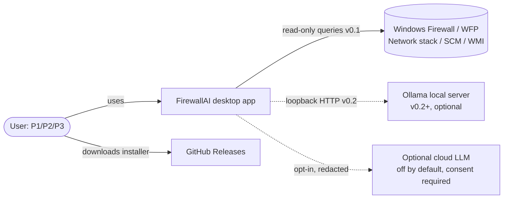
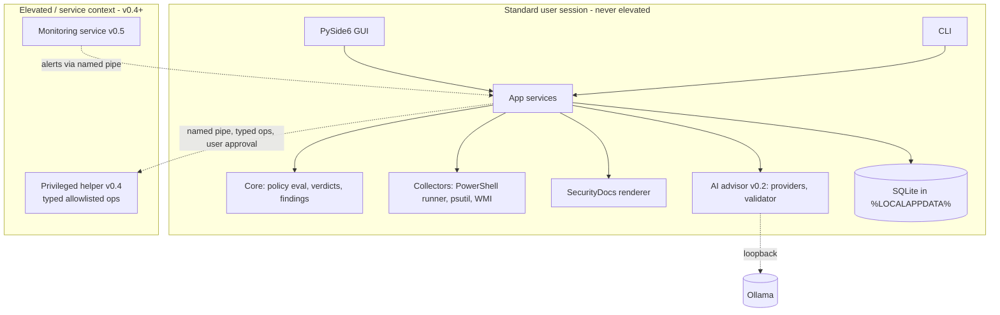
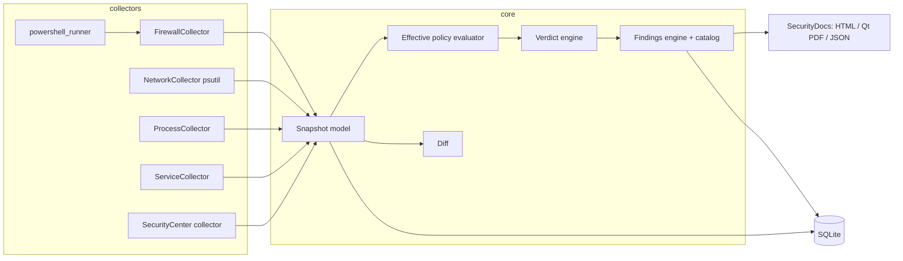
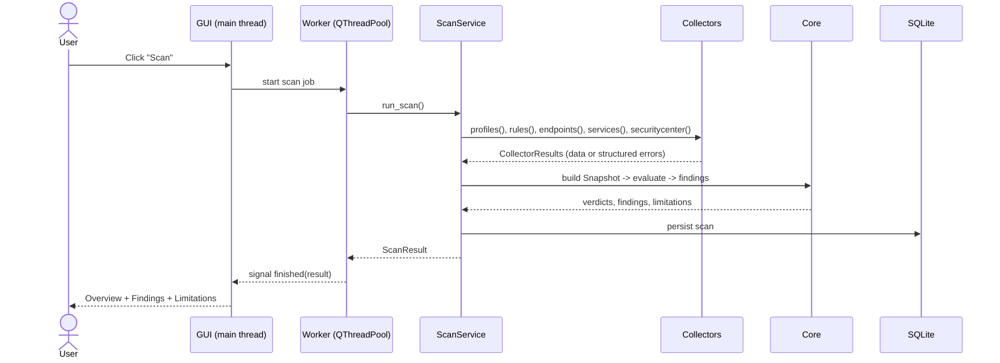
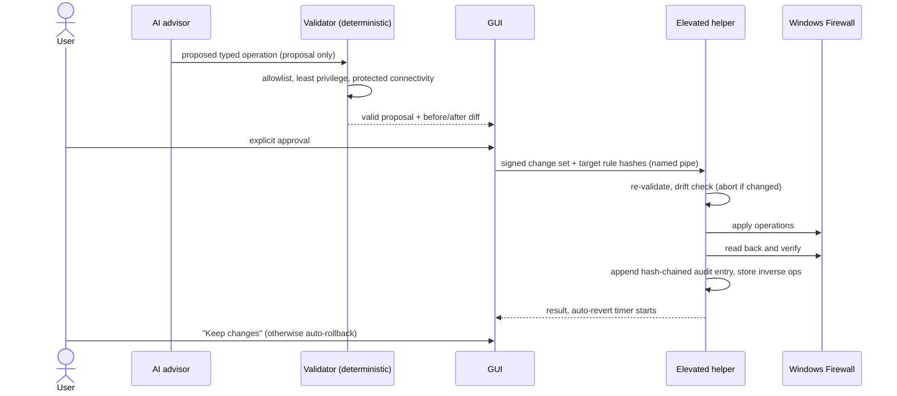
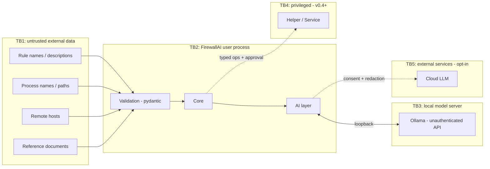

# 03: Software Architecture

Status: Approved plan rev. 3, frozen snapshot of the *rationale*. The current implementation reference lives in [../architecture/](../architecture/). Covers deliverables (4) architecture, (5) Mermaid diagrams, and (14) folder structure.

## 1. Architectural style

- **Layered, ports-and-adapters architecture with dependencies pointing inward.**
- `core` is pure. It holds the domain models and the logic for policy evaluation, verdicts, findings, and diff, and it has no I/O.
- Platform access sits behind `Protocol` interfaces in `collectors`. A fixture-backed fake implementation lets most logic be tested without Windows.
- The GUI and CLI both call one application-service layer (`app`).
- Privileged operations (v0.4+) run in a **separate process** and never in the UI or AI process.

Why: the core is testable, platform quirks are isolated, the AI and docs packages can be extracted later, and the privilege boundary is clear.

## 2. Diagrams

### 2.1 System context (C4 level 1)


### 2.2 Containers (all versions)


### 2.3 v0.1 components


### 2.4 Scan sequence (v0.1)


### 2.5 Future change request (v0.4, design)


### 2.6 Trust boundaries


## 3. Key design rules

- `core` imports nothing platform-specific. Collectors return validated pydantic models.
- `CollectorResult` carries data or structured errors, so partial data is explicit.
- The UI does all long work in `QThreadPool` workers and communicates through signals. No blocking calls run on the main thread.
- The `ai` and `securitydocs` packages don't depend on FirewallAI-specific modules ([ADR 0013](../adr/0013-shared-package-extraction.md)).
- The privileged component is a separate process, and its operation schema is shared ([07](07-security-model.md)).

## 4. Repository folder structure (target)

```
FirewallAI/
├─ AGENTS.md  CLAUDE.md  AI_DEVELOPMENT.md  README.md  LICENSE
├─ pyproject.toml  uv.lock                         (Sprint 1)
├─ src/firewallai/
│  ├─ app/          application services
│  ├─ core/         models/, effective_policy/, verdicts/, findings/ (catalog YAML + rules), diff/
│  ├─ collectors/   windows/ (powershell_runner, firewall, network, process, service, securitycenter, scripts/*.ps1), fake/
│  ├─ storage/      repository, migrations/
│  ├─ securitydocs/ model, templates/, renderers/
│  ├─ references/   registry data + loader
│  ├─ ai/           (v0.2) providers/, redaction, consent, schemas, validator, eval/
│  ├─ ui/           views/, models/, theme/, onboarding/
│  └─ cli/
├─ tests/  unit/ integration/ ui/ security/ ai_eval/ fixtures/ benchmarks/
├─ packaging/  pyinstaller/ inno/ manifest/
├─ scripts/    fixture recorder + sanitizer, benchmarks
├─ docs/  planning/ architecture/ adr/ development/ user/
└─ .github/  workflows/ pull_request_template.md
```
