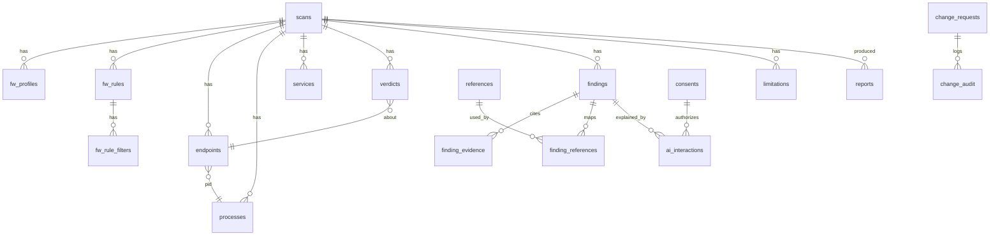

# 08: Database and Data Model

Status: Approved plan rev. 3, frozen snapshot. Covers deliverable (10).

## 1. Storage decisions
- SQLite through the stdlib `sqlite3`, with WAL mode and foreign keys on.
- Hand-written, numbered SQL migrations, tracked in `schema_version`.
- Location: `%LOCALAPPDATA%\FirewallAI\firewallai.db`, with a user-only ACL.
- **Snapshot model:** every scan is immutable, and every collected row references `scan_id`. Diffs compare two snapshots.
- No secrets are ever stored in the database. Retention is configurable (default: keep the last 50 scans [ASSUMPTION; tune later]).
- Raw untrusted strings are stored as data and escaped when displayed or rendered.

## 2. Entity-relationship diagram (v0.1, plus planned v0.2–v0.4 tables)

## 3. Tables

| Table | Key columns | Notes |
|---|---|---|
| `schema_version` | version, applied_at | Migrations |
| `scans` | id, started_at, finished_at, status, app_version, catalog_version, privilege_level, host_fingerprint_hash, os_build, collector_errors_json | `host_fingerprint_hash` is a salted hash, never a raw hostname |
| `fw_profiles` | scan_id, name, enabled, default_inbound, default_outbound, allow_inbound_rules, allow_local_fw_rules, allow_local_ipsec_rules, log_allowed, log_blocked, disabled_interfaces_json, active_interfaces_json | |
| `fw_rules` | scan_id, instance_id, name, display_name, group, direction, action, enabled, profiles, policy_source, edge_traversal, override_block, rule_hash | `rule_hash` is computed over normalized effective fields, for diff and drift detection |
| `fw_rule_filters` | scan_id, instance_id, kind (port, address, application, service, interface, interface_type, security, package), data_json | Normalized filters |
| `endpoints` | scan_id, id, proto, family, local_addr, local_port, remote_addr, remote_port, state, pid | Listeners have state LISTEN or NONE (UDP) |
| `processes` | scan_id, pid, name, exe_path, exe_available, signer, sha256 (optional, ADR 0010) | |
| `services` | scan_id, name, display_name, pid, status, start_type | |
| `verdicts` | scan_id, endpoint_id, profile, verdict, reasons_json, matched_rule_ids_json, qualifiers_json | |
| `findings` | scan_id, id, catalog_id, catalog_version, severity, confidence, title, status (open, suppressed) | |
| `finding_evidence` | finding_id, evidence_kind, evidence_ref | Points to rule, endpoint, or profile rows |
| `limitations` | scan_id, code, detail, count | e.g. `PROCESS_INFO_UNAVAILABLE` |
| `suppressions` | catalog_id, match_json, reason, created_at | User-acknowledged findings |
| `references` | id, framework, version, control_id, title, url, license_class, excerpt_allowed, reviewed | v0.1 minimal, v0.3 full ([11](11-standards-references.md)) |
| `finding_references` | catalog_id, reference_id, relation ("relates to") | Human-maintained |
| `reports` | id, scan_id, format, path, created_at, redaction_profile | |
| `settings` | key, value_json | **No secrets** |
| *v0.2* `consents` | id, provider, scope, payload_hash, granted_at | |
| *v0.2* `ai_interactions` | id, finding_id, provider, model, model_digest, prompt_hash, response_json, validation_status, consent_id, created_at | Prompt text is stored only if the user enables it |
| *v0.4* `change_requests` | id, ops_json, inverse_ops_json, target_hashes_json, status, approved_at | |
| *v0.4* `change_audit` | seq, change_request_id, event, data_json, prev_hash, entry_hash | Append-only hash chain (lives in the helper's own store) |
